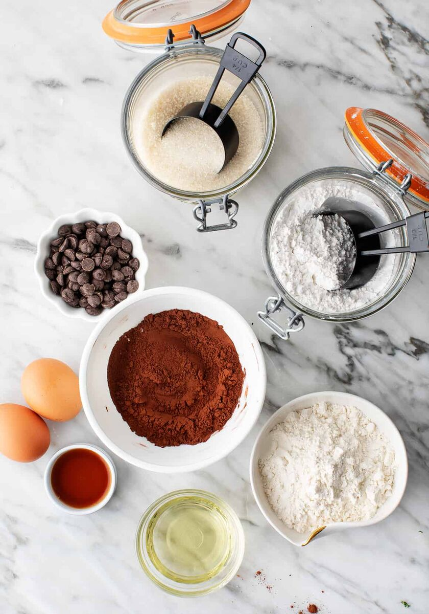
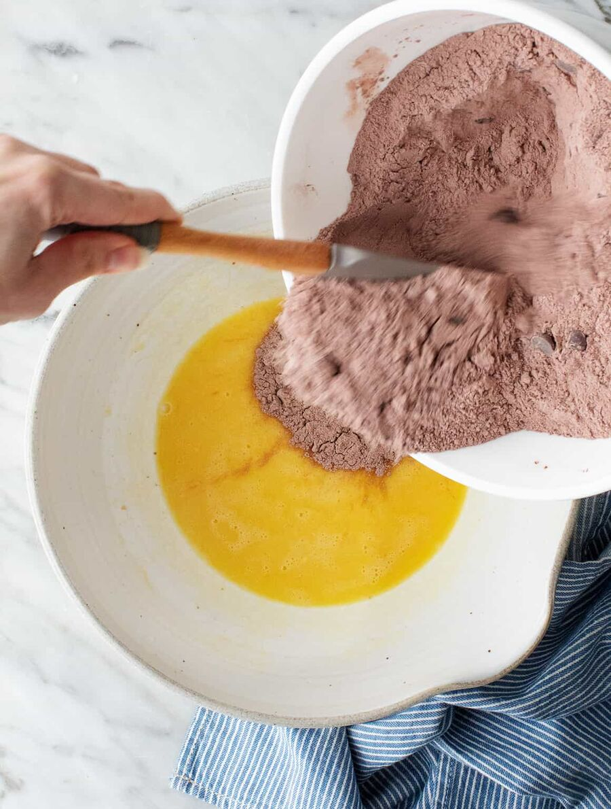
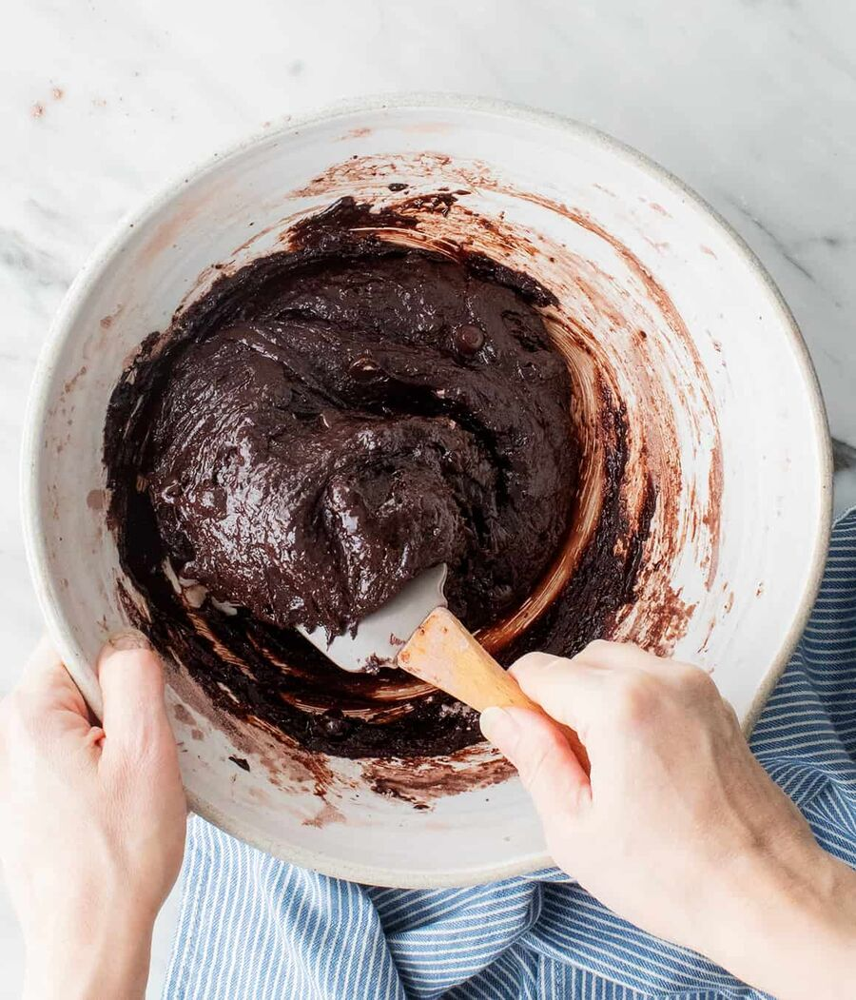
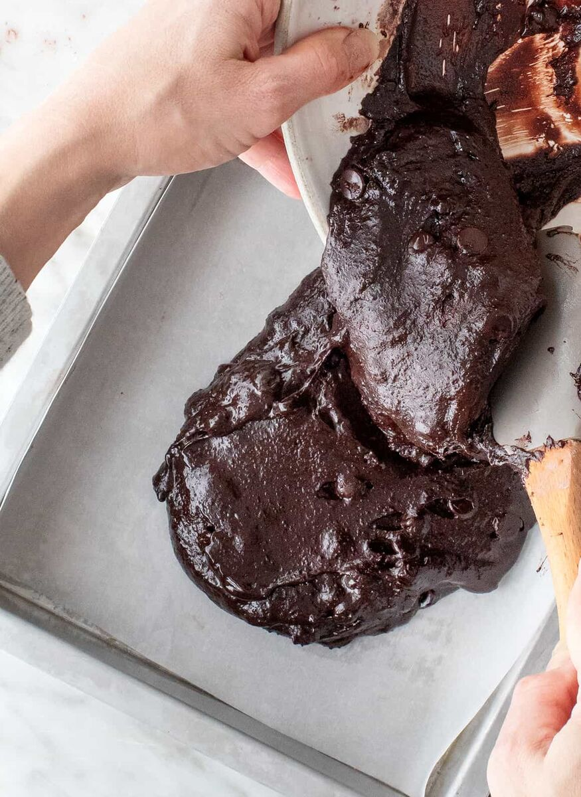
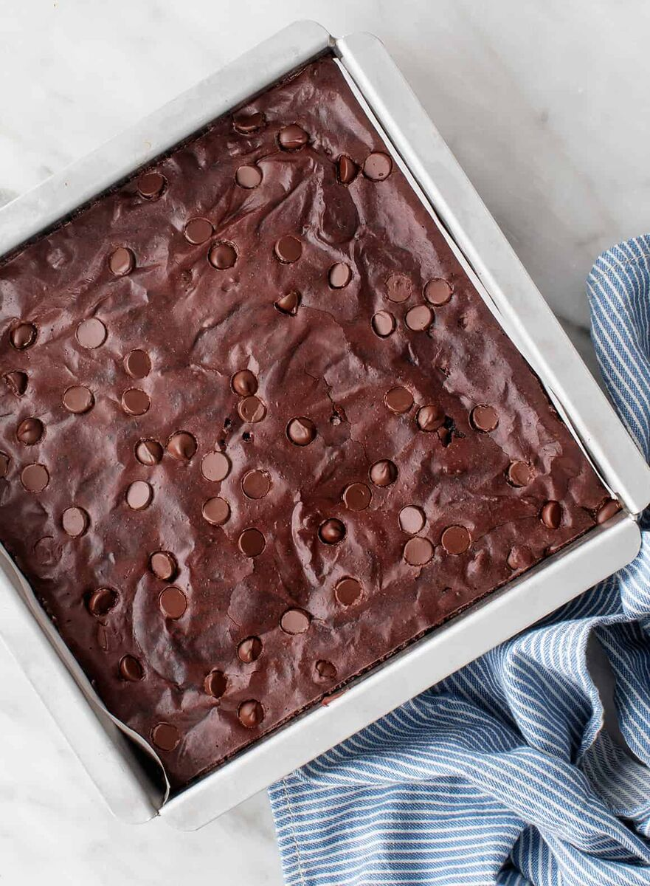
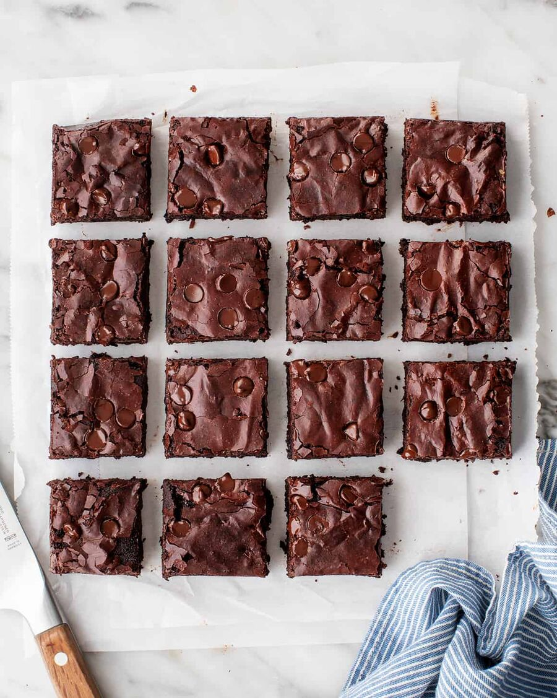

1. **Get ready.** Heat the oven to 165 °C (150 °C fan). Grease a 20 × 20 cm baking tin (a 23 × 23 cm one works too), line it with baking paper and grease the paper.

   

2. **Mix the dry ingredients.** In a medium bowl, stir together the sugar, flour, cocoa, powdered sugar, chocolate chips and salt.

3. **Mix the wet ingredients.** In a large bowl, whisk the eggs, oil, water and vanilla together.

4. **Combine.** Sprinkle the dry mix over the wet one and fold until just combined. The batter will be very thick.

   

   

5. **Bake.** Scrape the batter into the tin and smooth the top with a spatula. Bake for 40–55 minutes, until the edges are set and a toothpick in the middle comes out mostly clean, with just a thin film of batter. Take them out sooner rather than later; a 23 cm tin will be done earlier than a 20 cm one.

   

   

6. **Cool, then slice.** Let them cool completely in the tin, about 2 hours, so they set, then cut into 16 squares.

   
