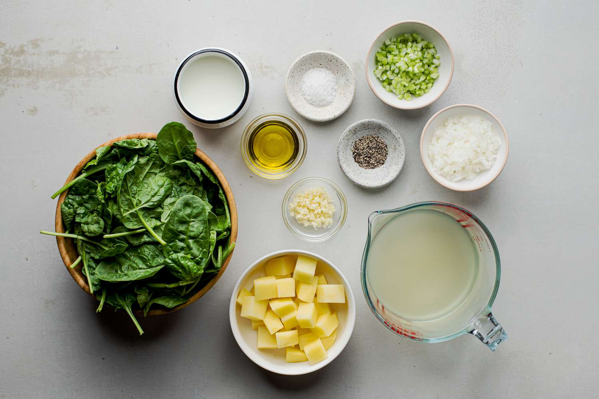
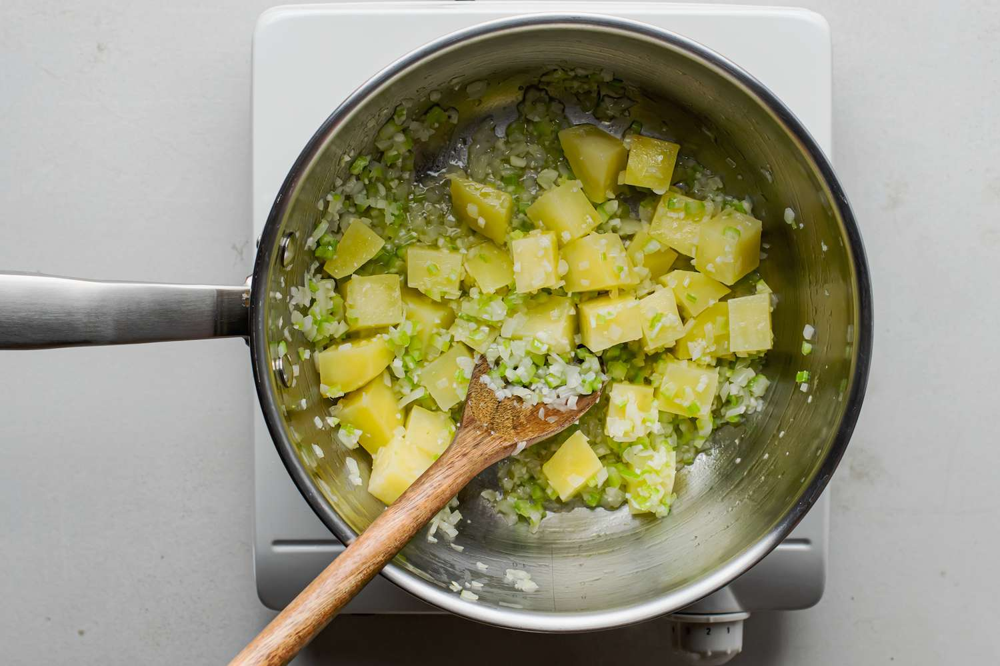
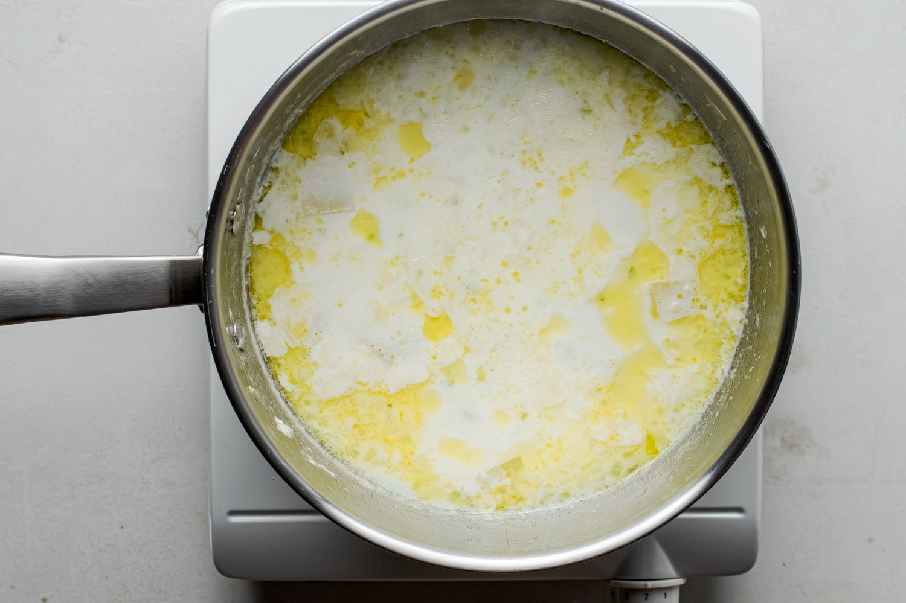
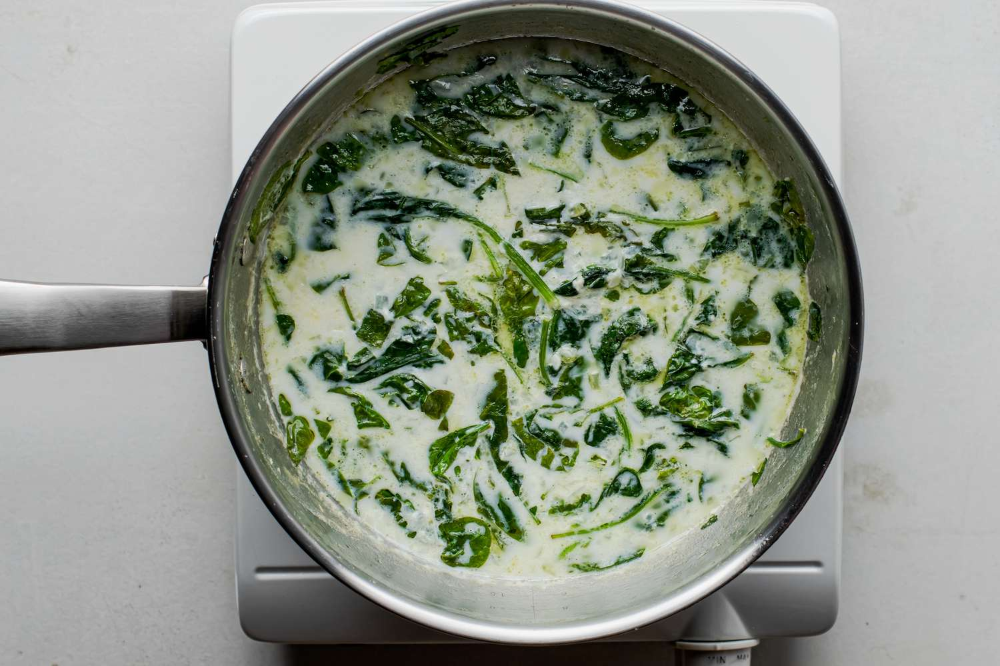
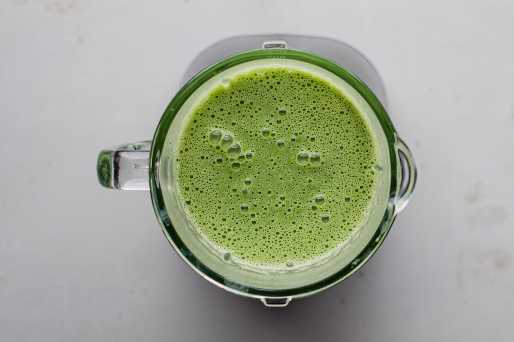
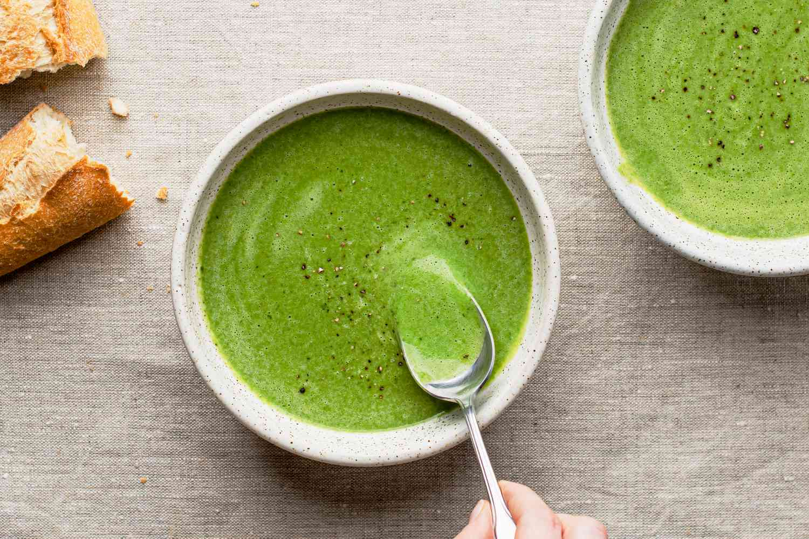

1. **Gather the ingredients.**

   

2. **Sauté the vegetables.** In a large saucepan or Dutch oven, heat the olive oil. Sauté the potato, onion, celery and garlic for 5 minutes.

   

3. **Simmer.** Add the broth and milk. Bring to a boil, cover, and simmer on low for 10 minutes.

   

4. **Add half the spinach.** Stir in half of the spinach (3 oz ≈ 85 g), cover, and simmer for 10 more minutes.

   

5. **Blend.** Let it cool slightly, then transfer the soup to a blender — in 2 batches if needed, so the hot soup doesn't overflow — or use an immersion blender in the pot. Add the remaining spinach and blend until smooth.

   

6. **Serve.** Taste for seasoning and serve.

   
