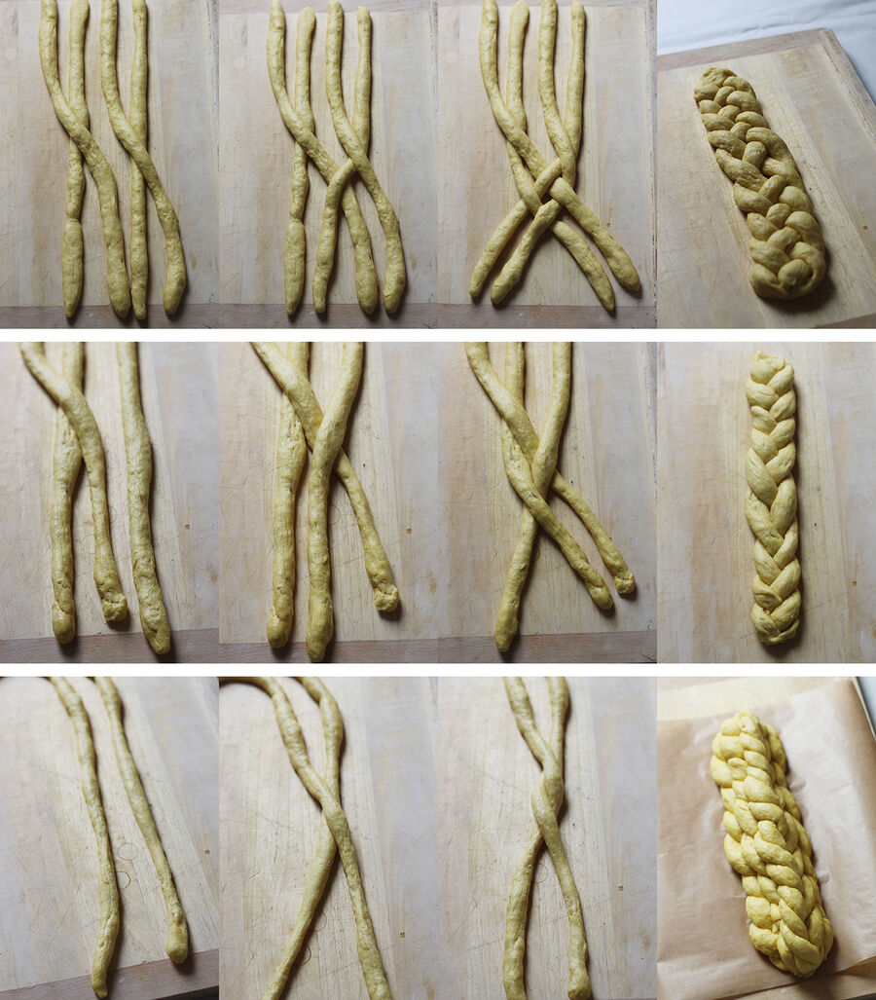

1. **Make the starter (kvásek).** Stir the yeast with 50 g of the sugar until runny, add about 100 ml of the warm milk and leave it in a warm place for 10–15 minutes, until frothy.

2. **Mix the dough.** In a large bowl (or a stand mixer with the dough hook), beat the egg, softened butter and the rest of the sugar together. Add the salt, nutmeg and lemon zest. Then add the flour, the starter and the rest of the warm milk in turns.

3. **Knead.** Knead into a smooth, elastic dough that no longer sticks to the bowl, about 10 minutes. Add a little flour if it's too soft or a splash of milk if it's too stiff. Knead in the raisins and chopped almonds at the end.

4. **Rise twice.** Cover and leave to rise for 1 hour. Knock it back, knead briefly, and leave for another hour.

5. **Divide.** Line a baking tray with baking paper. Divide the dough into 9 equal pieces (weigh them) and roll each into a strand of the same length, about 40 cm.

6. **Braid in three tiers.** Braid 4 strands into the base and put it straight onto the tray. Press a shallow groove along the middle with the side of your hand, braid 3 strands, and lay them on top. Twist the last 2 strands together and lay them on top as the crown. Tuck the ends under, and push 3 wooden skewers down through all the layers so nothing slides.

   

7. **Final rise.** Cover with a tea towel and leave on the tray for 45 minutes, until puffy. Meanwhile heat the oven to 160 °C.

8. **Glaze and bake.** Brush the loaf all over with the egg wash, getting into the gaps between the braids, and scatter with the flaked almonds. Bake for 45 minutes, until deep golden and hollow-sounding when tapped underneath.

9. **Finish.** Let it cool on a rack, pull out the skewers, and dust with powdered sugar.
