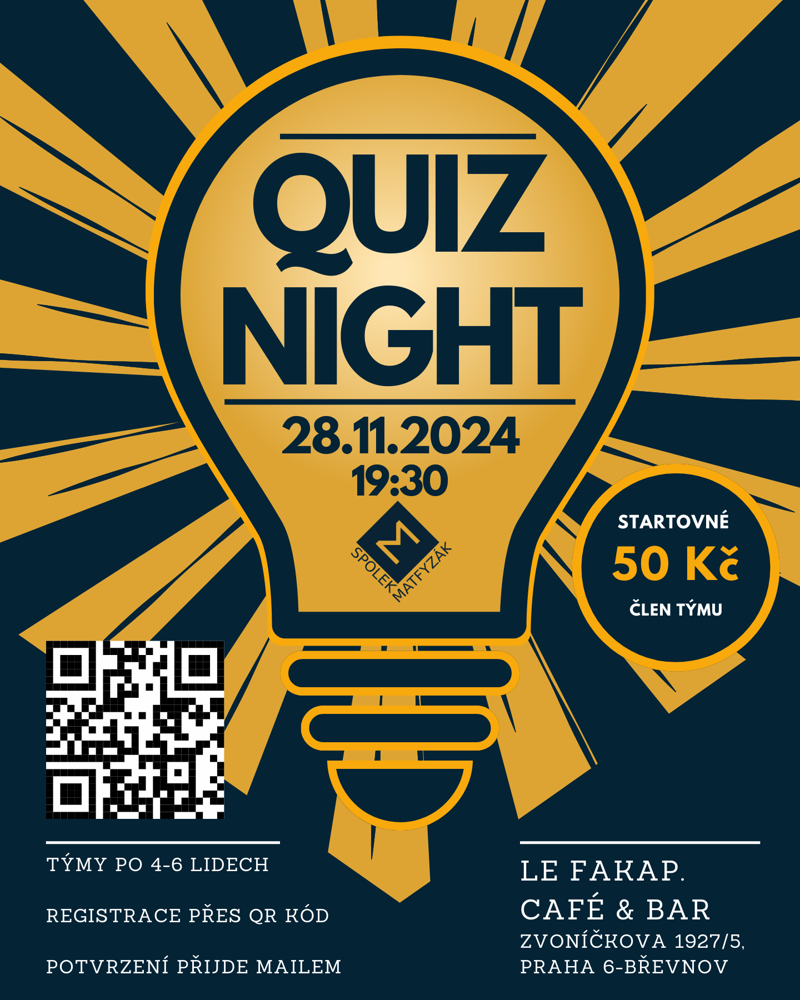
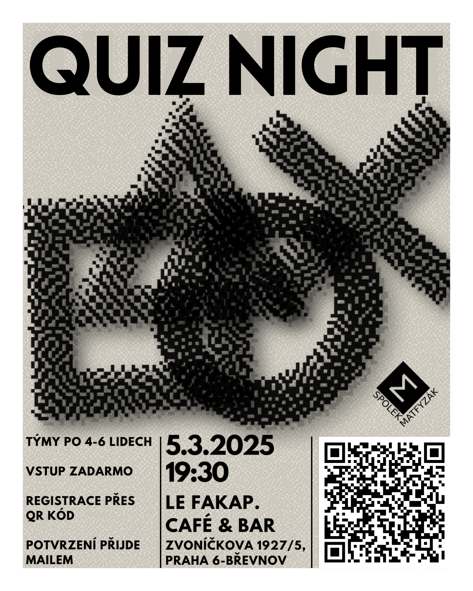
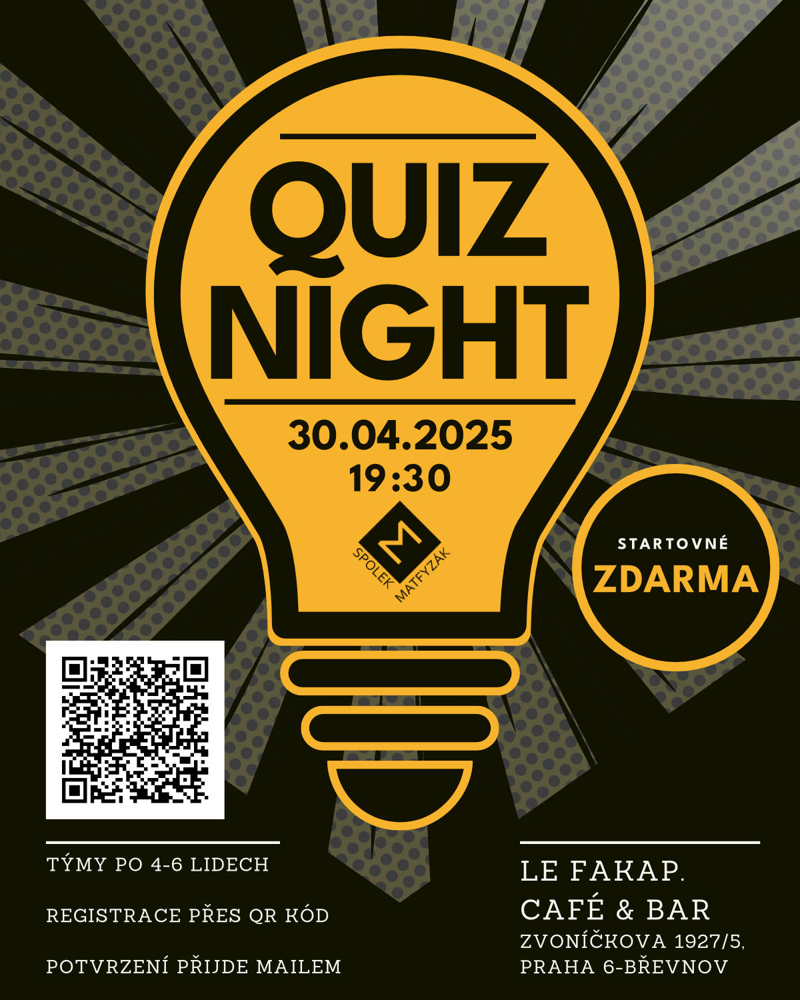
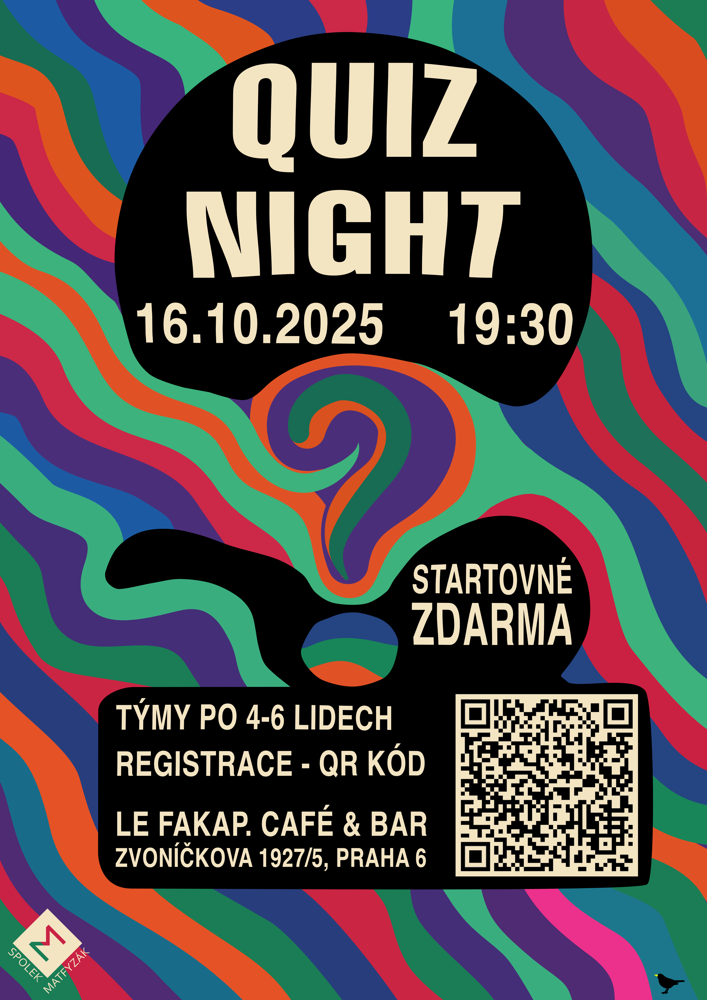
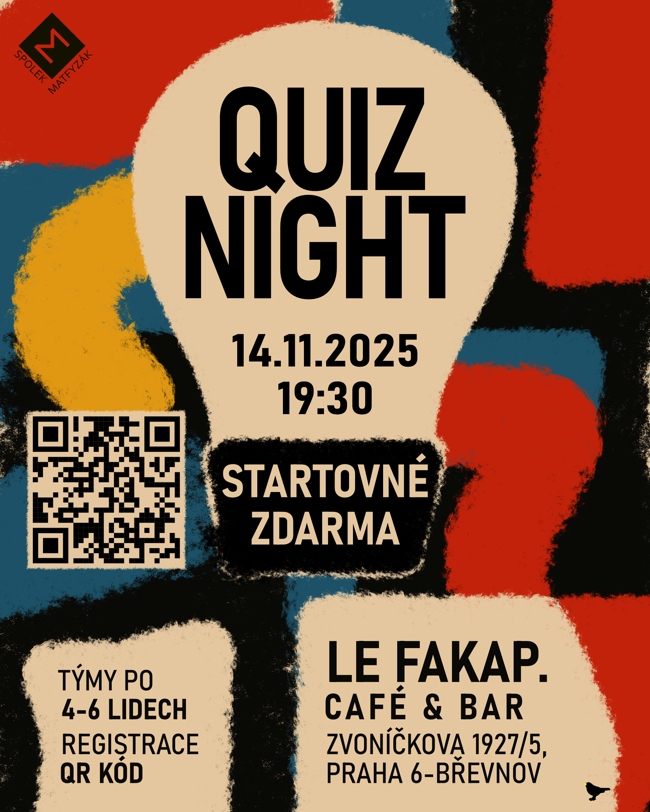
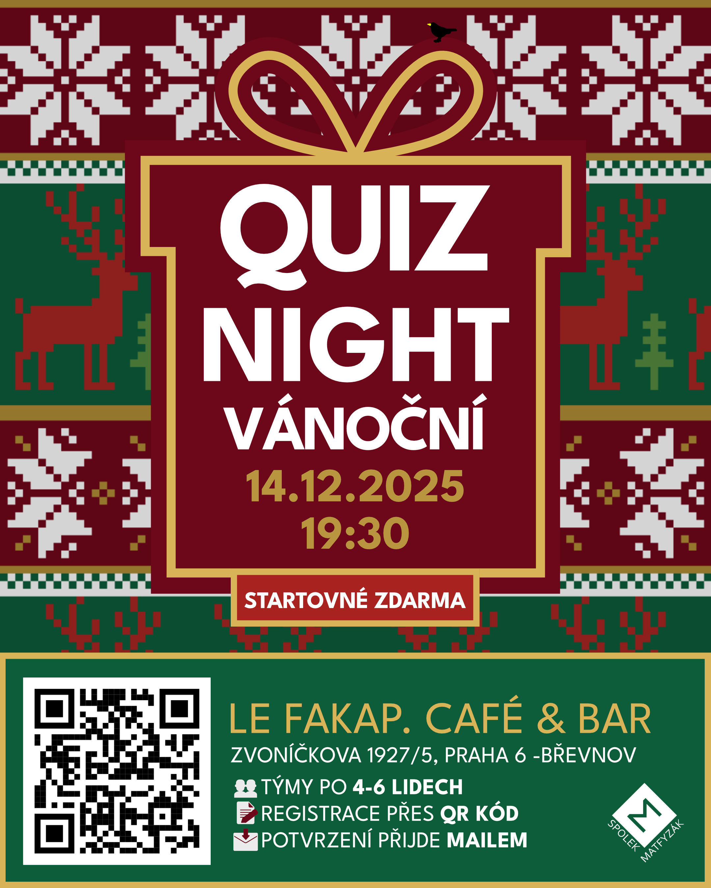
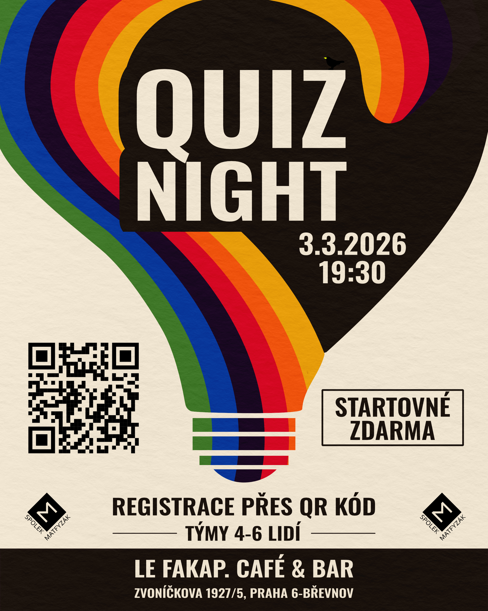

I kind of like making posters. Made a few, here you can take a look.

## Quiz Night

For being the first I still really like this one. I've made it in Canva. 

This one was not so great, I was getting a lot of pixelized art on my feed and thought I would try it out. 
The lesson is that the pixelization works the best on complicated images like photographs, not some simple shapes. 
Also when doing pixel art, dithering effects are the best which I didn't do. Lesson learned but I've found good inspiration.
- [webapp](https://effect.app/features)
- [dithering](https://visualrambling.space/dithering-part-1/)

This one was done because I had little time and inspiration. But I know that I don't like shuffling variants of the same. 
So I won't do this again probably (if I have the time I will try to make something new).

Here I started using Affinity Designer. I call this one psychadelic.

This might be my favourite. Doing it was quite simple but the result is great in my opinion. I call this one brutalist.

Here I wanted to make a Christmas theme, so a color scheme and replacing the lightbulb with present was almost obvious choice.
I wanted something like the Christmas sweater patterns as background but I couldn't find anything good or without watermark. So I took 
this as an opportunity to learn [Aseprite](https://www.aseprite.org/), which came in handy when we were doing GDS Prague Game Jam 2025.

I was searching for a while for some inspiration to make this poster. It turned out okay, but next time I am planning on using 
album's of my favourite bands and doing Quiz Night version of them. Also if you are interested what was the inspiration, here it is, [VIII Przegląd Filmów o Sztuce](https://pin.it/1N7TjHW5V)
